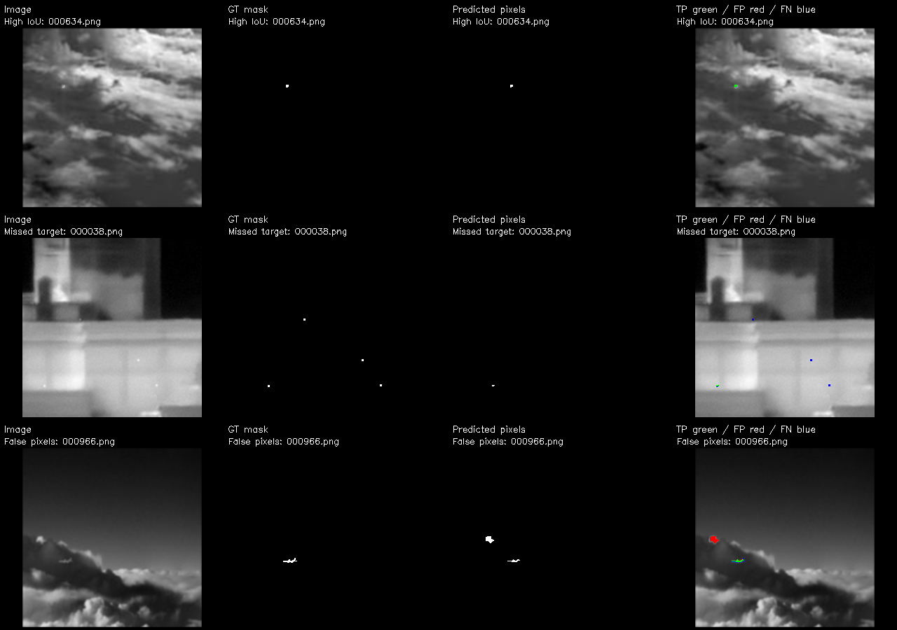

# NUDT-SIRST 像素级检测报告

生成时间：2026-10-21T16:48:27.711095+08:00。检测全部选定图片，无矩形框输出。

## 实验设置

- 权重：`C:\Users\Kyson\Desktop\IRSTD\wideirstd_yolo26n_seg_scratch\weights\best.pt`（WideIRSTD-Full 从零训练的最佳权重）。
- 图片数：1327；输入尺寸 1024；实例置信度阈值 0.25；不做事后去噪、膨胀或面积筛选。
- 预测掩膜以原图分辨率输出。全部前景像素坐标见 pixels/*.json，格式为从左上角起算的零基 [x,y]。
- 使用掩膜的并集做二值前景评估；JSON 的 confidence 为实例置信度，不是逐像素概率。

## 主要发现

- 本次 1327 张图中，1128 张与模型训练集、199 张与模型验证集的解码灰度像素完全一致；没有可据此认定为独立未见的图片。
- 像素精确率 88.57%，召回率 58.98%：预测前景较少混入背景，但仍遗漏约 41.02% 的真值前景像素。
- 按本报告的 3 像素质心规则命中 1546/1863 个目标；目标命中不等于轮廓完整，掩膜覆盖仍有改善空间。
- 样例中既有目标完全漏检，也有云边误检；不能把全部像素缺失都归因为边缘欠分割。

## 指标结果

| 图片范围 | 图片数 | 像素 IoU | Dice | 像素精确率 | 像素召回率 | 逐图平均 IoU | 目标命中率（3 px） |
|---|---:|---:|---:|---:|---:|---:|---:|
| 全部 | 1327 | 54.80% | 70.81% | 88.57% | 58.98% | 47.73% | 82.98% |
| NUDT 原训练划分 | 663 | 54.93% | 70.91% | 89.30% | 58.80% | 47.10% | 82.68% |
| NUDT 原测试划分 | 664 | 54.68% | 70.70% | 87.83% | 59.16% | 48.37% | 83.28% |

总计：真值连通目标 1863 个；命中 1546 个；漏检 317 个；未匹配预测连通域 90 个。
像素 TP=34001，FP=4388，FN=23651。每百万图像像素中误报 50.456 个像素。

## 指标定义与解释边界

- 像素 IoU=TP/(TP+FP+FN)；Dice=2TP/(2TP+FP+FN)，均先跨图累加像素数。
- 逐图平均 IoU 为各图 IoU 的算术平均；空真值且空预测时记为 1。
- 目标以掩膜 8 连通域定义。真值与预测的质心距离不超过原图 3 像素，一对一匹配，统计命中率。
- 这是本报告明确定义的定位指标；它不要求轮廓 IoU 达标，不能与定义不同的论文 Pd/Fa 直接比较。
- 未定义的比值不会强制填零。背景占比很高，因此不把像素准确率作为主要结论。

## 训练数据重叠核查

全部图片中，0 张与本次模型训练集存在字节完全相同的文件，0 张与模型验证集存在字节完全相同的文件。
WideIRSTD 包含 NUDT-SIRST 来源数据；NUDT 的原测试划分并不自动成为当前模型的未见测试集。本次结果用于检查当前模型的像素预测表现，不能作为独立跨域泛化证据。
进一步比较同尺寸的解码灰度像素（不缩放、不做近似匹配），1128 张与训练集完全一致，199 张与验证集完全一致。因此全部 1327 张均属于已见图像。文件字节不同是编码等差异，不能据此认定内容不同。详见 overlap_audit.json 与 decoded_pixel_overlap.json。裁剪、缩放及相似图像不在本次精确匹配覆盖范围内。

## 代表样例

下面分别展示高 IoU、漏检较多和误检像素较多的样例；绿色为正确前景、红色为误检、蓝色为漏检。

- High IoU：000634.png，IoU=0.9333，FN=1，FP=0。
- Missed target：000038.png，IoU=0.1622，FN=30，FP=1。
- False pixels：000966.png，IoU=0.2426，FN=24，FP=79。

## 文件与耗时

- masks/：0/255 黑白预测掩膜，每张图一份。
- pixels/：全部前景像素 [x,y] 和预测实例的面积、质心、置信度，无目标框字段。
- overlays/：原图叠加红色预测像素，无目标框。
- comparisons/：原图叠加 TP/FP/FN 像素，无目标框。
- per_image.csv：逐图指标；summary.json：完整汇总与参数；overlap_audit.json：重叠记录。
- 预测及保存耗时 29.0 秒；含重叠核查总耗时 36.0 秒。
- 框架记录的平均纯推理耗时 7.07 ms/图，不含预处理、后处理和文件保存，不等同于端到端延迟。

补充：解码像素重叠核查在主预测运行完成后另行执行，不计入上述 36.0 秒。
