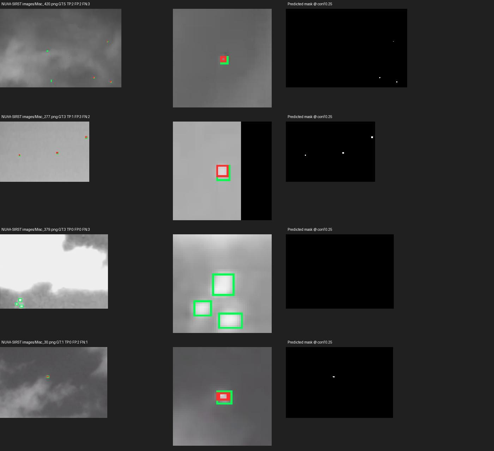
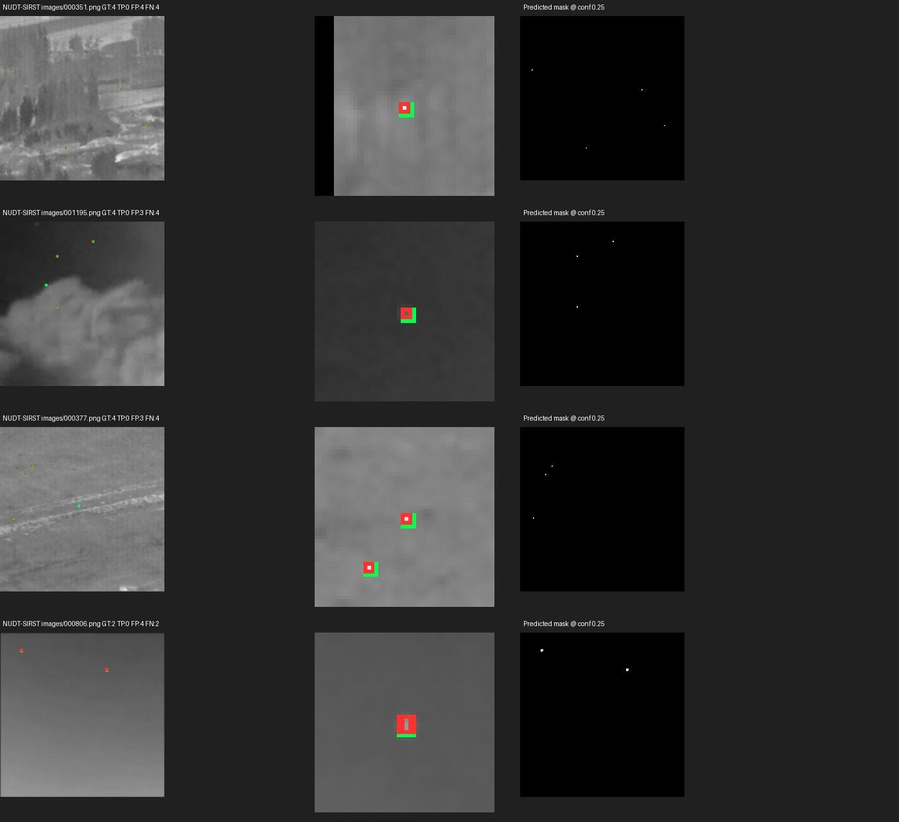

# NUAA-SIRST 与 NUDT-SIRST 模型检测报告

日期：2026-10-20。沿用前一轮的 YOLO26n 分割最佳权重，仅执行推理与评估，未重新训练。

从本地两套数据的 test 清单选取全部有效配对，共 **877 张图**。NUAA-SIRST 清单214张，其中1张图像/掩膜尺寸不一致被排除，实际213张；NUDT-SIRST 664张全部纳入。两套预测框均保持原始大小（pad=0）。

## 1. 使用哪个模型

- 权重：`C:/Users/Kyson/Desktop/掩膜/all4_yolo26n_segment_best.pt`，单类别 target。
- 用户表格中的 ACM、DNANet 用于说明 SIRST、NUDT-SIRST 的论文/数据集对应关系；此次调用的是上文已训练的 YOLO26n 分割模型。
- NUAA-SIRST 和 NUDT-SIRST 都是此模型的训练数据来源。本次按已有 test 清单评估，属于同来源留出集测试，不属于上一轮 IRDST/ITSDT-15K 的新数据域测试。

## 2. 数据选取和质量检查

|数据集|清单图片数|实际检测|排除|文件名与现有模型测试划分一致|测试文件名与训练/验证交集|
|---|---:|---:|---:|---|---:|
|NUAA-SIRST|214|213|1|是|0|
|NUDT-SIRST|664|664|0|是|0|

测试清单分别位于本地数据集的 `img_idx/test_NUAA-SIRST.txt` 与 `img_idx/test_NUDT-SIRST.txt`。文件名无交集不等于彻底排除同源场景或变换后的关联；本次不把它当作完全独立跨域数据。

**排除样本：NUAA-SIRST / Misc_111。** 原图325×220，掩膜592×400，缺少可信的空间对应关系。未强行缩放掩膜或修改原数据；这张图不进入准确性统计。排除依据是配对质量，不是模型分数。详细路径见 `排除样本.json`。

## 3. 指标口径

- 原始二值掩膜中非零像素为前景，以8连通域定义实例；框为每个实例的紧外接框，右下边界采用 xmax+1/ymax+1。没有轮廓多边形近似或目标筛除。
- 输入 imgsz=1024、batch=8、GPU=0、retina_masks=True。保持预测框原始大小，不外扩。
- 保存 conf≥0.001 的候选，用 pycocotools 的 COCO 101点插值计算 AP50 和 AP50–95；COCO maxDets=100，推理最多300个实例/图。
- Precision/Recall/F1、TP/FP/FN 固定在 conf≥0.25、框 IoU≥0.50，以置信度降序一对一匹配。
- mask AP 使用实例掩膜；像素 IoU、Dice 对工作点预测掩膜并集计算。没有以背景像素占比很高的普通像素准确率充当检测质量。
- 本次使用原始像素掩膜；既有训练日志的验证器使用转换后的 YOLO 多边形标签，NUAA-SIRST 还少了上述无效样本，因此本次数值不应与旧日志直接当作同口径复现比较。

## 4. 框检测结果

|数据集|图像|目标框|AP50|AP50–95|Precision|Recall|F1|
|---|---:|---:|---:|---:|---:|---:|---:|
|NUAA-SIRST|213|262|80.94%|32.93%|78.46%|77.86%|78.16%|
|NUDT-SIRST|664|945|75.46%|33.65%|63.49%|76.72%|69.48%|

|数据集|TP 正确检测|FP 误检|FN 漏检|
|---|---:|---:|---:|
|NUAA-SIRST|204|56|58|
|NUDT-SIRST|725|417|220|

## 5. 分割结果

|数据集|mask AP50|mask AP50–95|全局像素 IoU|全局像素 Dice|像素 Precision|像素 Recall|
|---|---:|---:|---:|---:|---:|---:|
|NUAA-SIRST|72.40%|26.20%|56.43%|72.15%|85.06%|62.64%|
|NUDT-SIRST|64.40%|28.42%|64.43%|78.37%|88.38%|70.39%|

## 6. 图片结果

每张图均已保存可视化：绿色是真值框，红色是 conf≥0.25 的预测框，蓝色半透明区域为预测掩膜。预测掩膜 PNG 仅含0和255。

案例拼图前8张按工作点误检+漏检数量排序，后8张按测试清单均匀间隔抽取；拼图用于诊断，不代表随机抽样的总体表现。

### NUAA-SIRST



[全部逐图可视化](results/NUAA-SIRST/visualizations/) · [逐图指标](results/NUAA-SIRST/per_image.csv) · [预测框 TXT](results/NUAA-SIRST/prediction_txt/) · [完整案例图](results/NUAA-SIRST/cases.jpg)

### NUDT-SIRST



[全部逐图可视化](results/NUDT-SIRST/visualizations/) · [逐图指标](results/NUDT-SIRST/per_image.csv) · [预测框 TXT](results/NUDT-SIRST/prediction_txt/) · [完整案例图](results/NUDT-SIRST/cases.jpg)

## 7. 保存文件和复现

- `指标汇总.csv`：可用 Excel 打开的汇总，指标以0–1小数保存；本报告按百分比显示。
- `指标.json`：完整指标、模型 SHA256、设备、版本和运行参数。
- `数据选取说明.json`、`排除样本.json`、`核验结果.json`：划分、排除理由与结果一致性核验。
- `results/<数据集>/predictions_bbox.json`：COCO格式像素坐标框、分数，单类 category_id=1。
- `prediction_txt/<原图名>.txt`：固定工作点的 YOLO格式 `class xc yc w h conf`，class=0、坐标归一化。
- `predicted_masks/<image_id>.png`：预测掩膜并集；`manifest.json` 将 image_id 对应到原图路径。
- 模型 SHA256：`8d314abb8b9c11b298e357de3d25d88ba7f7955df7494ad51efbb1ff75d8d5bc`。

复现命令：
```powershell
& "C:\Users\Kyson\anaconda3\envs\yolo26\python.exe" -X utf8 -u "C:\Users\Kyson\Desktop\检测结果\scripts\run_detection.py" NUAA-SIRST --box-pad 0
& "C:\Users\Kyson\anaconda3\envs\yolo26\python.exe" -X utf8 -u "C:\Users\Kyson\Desktop\检测结果\scripts\run_detection.py" NUDT-SIRST --box-pad 0
```