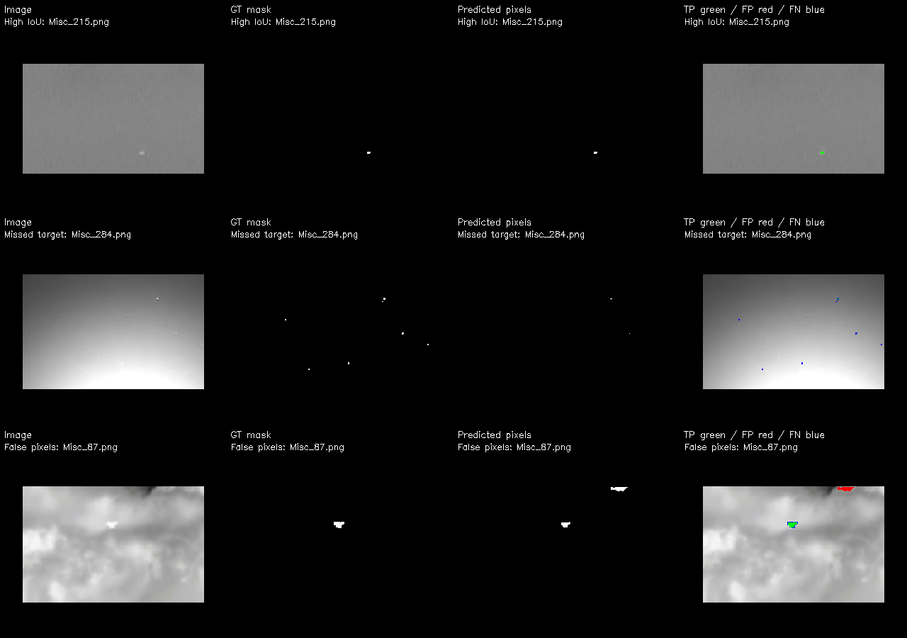

# SIRST 像素级检测报告

生成时间：2026-10-21T19:07:39.260720+08:00。检测全部选定图片，无矩形框输出。

## 实验设置

- 权重：`C:\Users\Kyson\Desktop\目标识别\outputs\NUDT_SIRST_seg_scratch\yolo26n_seg_scratch\weights\best.pt`（NUDT-SIRST 从零训练的最佳权重）。
- 图片数：427；输入尺寸 1024；实例置信度阈值 0.25；不做事后去噪、膨胀或面积筛选。
- 预测掩膜以原图分辨率输出。全部前景像素坐标见 pixels/*.json，格式为从左上角起算的零基 [x,y]。
- 使用掩膜的并集做二值前景评估；JSON 的 confidence 为实例置信度，不是逐像素概率。
- 有效评估图片 426 张；1 张真值读取/尺寸异常，保留预测但不计入指标。

## 结果解读

- 使用指定的 NUDT-SIRST 从零训练权重，完成 SIRST 全部 427 张预测；其中 426 张可进行像素对齐评估。
- 像素精确率 87.81%，召回率 40.15%。前景预测较保守，约 59.85% 的真值前景像素没有被覆盖，包含目标漏检和已命中目标的掩膜覆盖不足。
- 按 3 像素质心规则，命中 410/532 个真值连通目标，漏检 122 个；定位命中不代表轮廓准确。
- 对该模型实际使用的训练/验证图像做同尺寸灰度像素精确比较，未发现与 SIRST 完全相同的图片；未执行缩放或相似场景检索。

## 指标结果

| 图片范围 | 图片数 | 像素 IoU | Dice | 像素精确率 | 像素召回率 | 逐图平均 IoU | 目标命中率（3 px） |
|---|---:|---:|---:|---:|---:|---:|---:|
| 全部 | 426 | 38.03% | 55.11% | 87.81% | 40.15% | 41.54% | 77.07% |
| 数据集原训练划分 | 213 | 38.45% | 55.54% | 89.47% | 40.27% | 41.29% | 76.30% |
| 数据集原测试划分 | 213 | 37.58% | 54.63% | 86.05% | 40.02% | 41.79% | 77.86% |

总计：真值连通目标 532 个；命中 410 个；漏检 122 个；未匹配预测连通域 31 个。
像素 TP=7021，FP=975，FN=10465。每百万图像像素中误报 33.778 个像素。

## 指标定义与解释边界

- 像素 IoU=TP/(TP+FP+FN)；Dice=2TP/(2TP+FP+FN)，均先跨图累加像素数。
- 逐图平均 IoU 为各图 IoU 的算术平均；空真值且空预测时记为 1。
- 目标以掩膜 8 连通域定义。真值与预测的质心距离不超过原图 3 像素，一对一匹配，统计命中率。
- 这是本报告明确定义的定位指标；它不要求轮廓 IoU 达标，不能与定义不同的论文 Pd/Fa 直接比较。
- 未定义的比值不会强制填零。背景占比很高，因此不把像素准确率作为主要结论。

## 训练数据重叠核查

全部图片中，0 张与本次模型训练集存在字节完全相同的文件，0 张与模型验证集存在字节完全相同的文件。
进一步对比解码后的灰度像素（同尺寸、不缩放、不做近似匹配），0 张与训练集像素内容完全相同，0 张与验证集像素内容完全相同。
本次对比的实际训练数据目录为 `C:\Users\Kyson\Desktop\目标识别\datasets\NUDT_SIRST_seg_scratch`。数据集名称不同并不能保证没有重叠；若存在训练/验证图像匹配，相关图片的结果不能视为独立泛化证据。若未匹配，也仅表示在本次精确核查范围内未发现相同图片。
文件字节不同并不表示图片内容不同。核查还覆盖同尺寸解码灰度像素；裁剪、缩放及相似图像可能漏检，未匹配不等于确定未见。详见 overlap_audit.json。

## 代表样例

下面分别展示高 IoU、漏检较多和误检像素较多的样例；绿色为正确前景、红色为误检、蓝色为漏检。

- High IoU：Misc_215.png，IoU=1.0000，FN=0，FP=0。
- Missed target：Misc_284.png，IoU=0.1250，FN=42，FP=0。
- False pixels：Misc_87.png，IoU=0.3633，FN=37，FP=119。

## 真值异常

[{"image": "Misc_111.png", "image_shape_hw": [220, 325], "mask_shape_hw": [400, 592]}]
异常样例的 per_image.csv 真值相关指标留空，不按零分处理；没有修改或缩放原始真值。

## 文件与耗时

- masks/：0/255 黑白预测掩膜，每张图一份。
- pixels/：全部前景像素 [x,y] 和预测实例的面积、质心、置信度，无目标框字段。
- overlays/：原图叠加红色预测像素，无目标框。
- comparisons/：原图叠加 TP/FP/FN 像素，无目标框。
- per_image.csv：逐图指标；summary.json：完整汇总与参数；overlap_audit.json：重叠记录。
- 预测及保存耗时 8.9 秒；含重叠核查总耗时 9.9 秒。
- 框架记录的平均纯推理耗时 7.27 ms/图，不含预处理、后处理和文件保存，不等同于端到端延迟。
