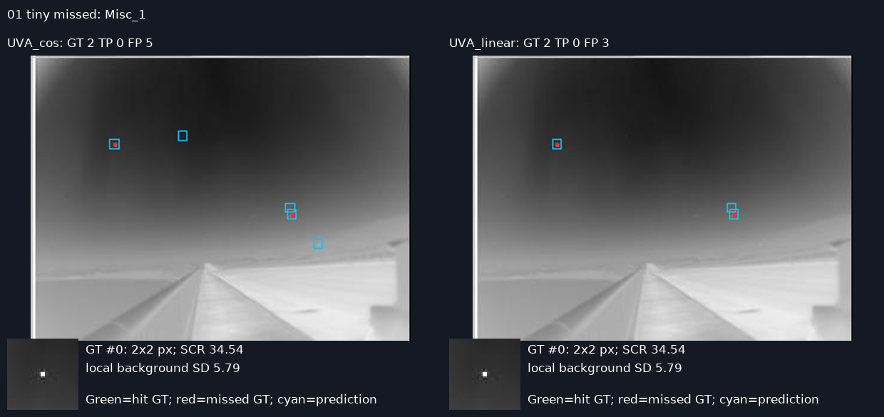
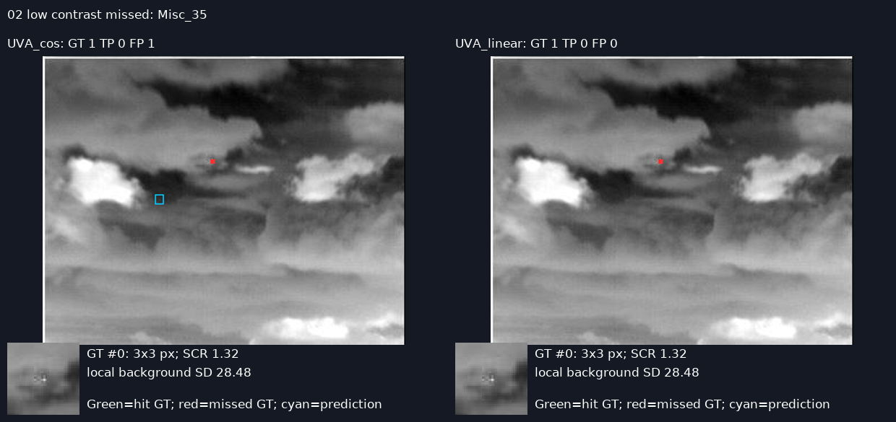
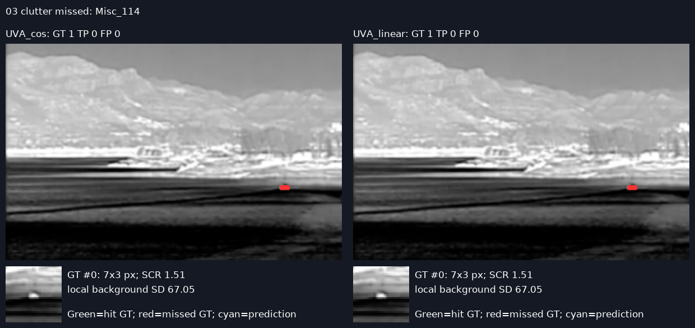
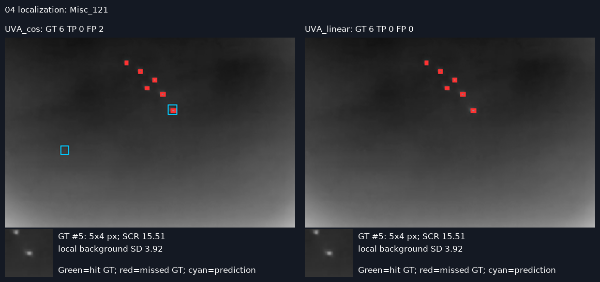
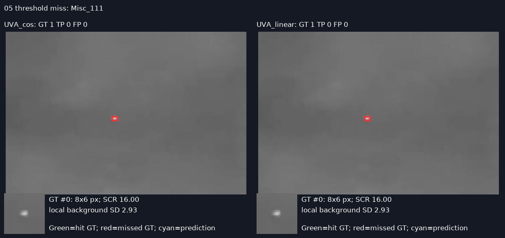
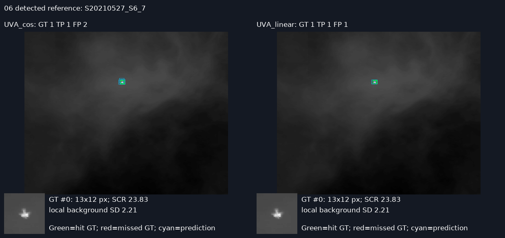
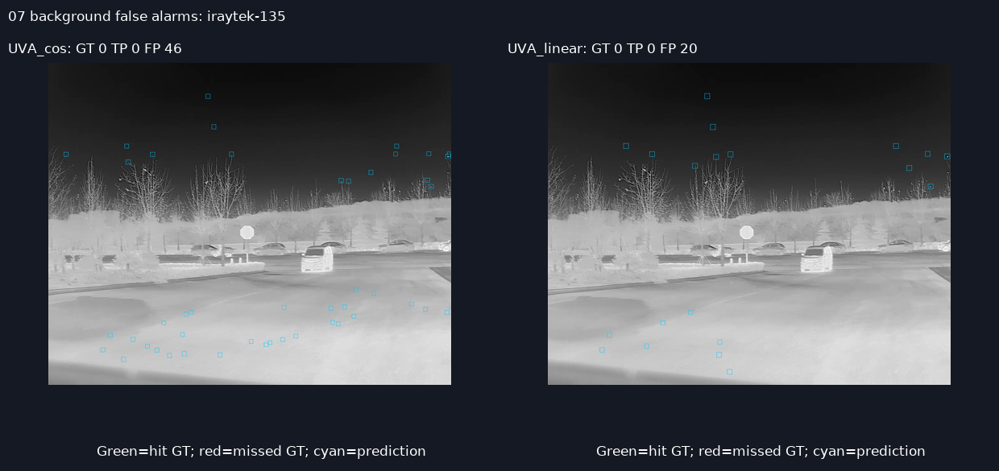
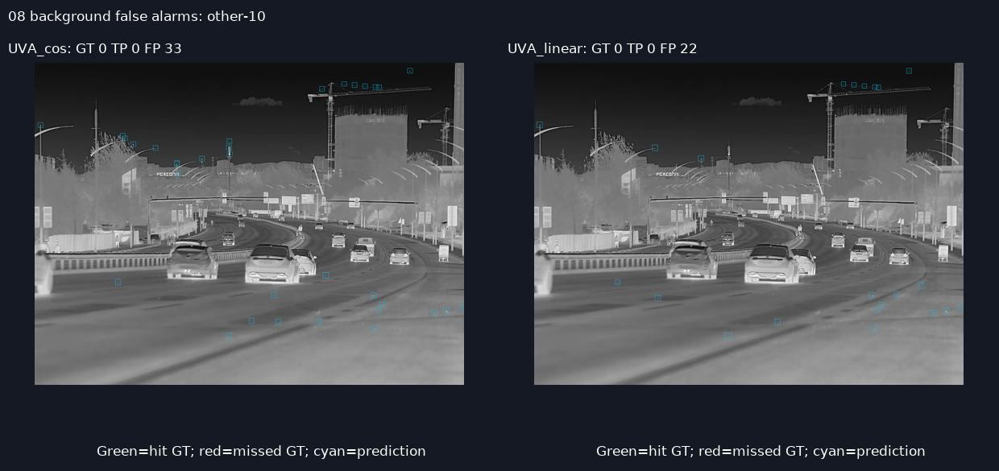
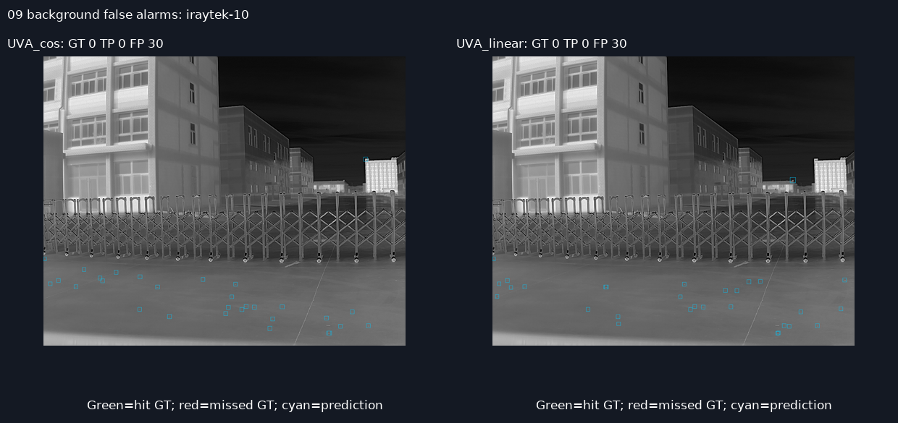
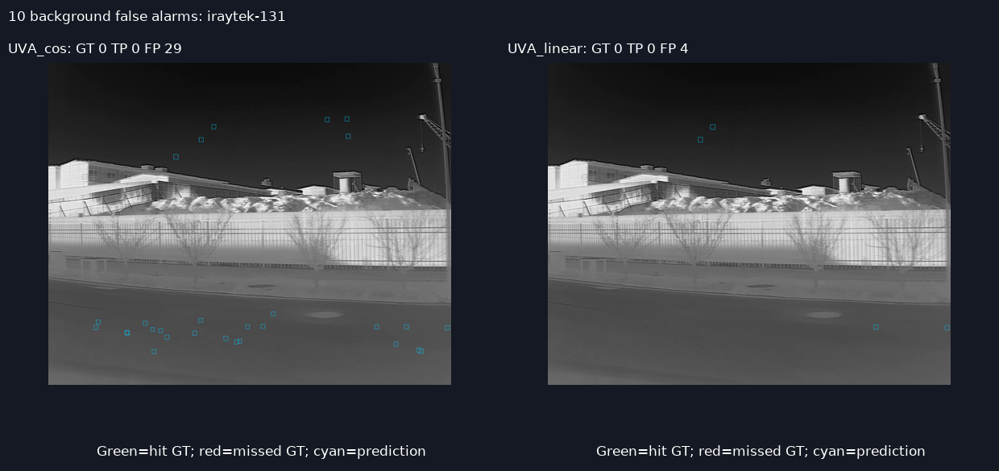

# 两份 UVA 模型的公开红外数据实测报告

评测日期：2026-09-19。仅加载桌面两份 best.pt 做推理，没有重新训练或用公开数据调参。

**结论：两模型在原验证集仍正常，但不能直接泛化到本次公开小目标数据。严格框检测性能很低；框尺寸不匹配和复杂背景虚警同时存在。无余弦退火模型在部分外部指标略好，但不能据此认定线性调度普遍优于余弦退火。**

## 1. 数据来源与评测范围

- [SIRST v1 官方仓库](https://github.com/YimianDai/sirst)：427 张，官方 idx_427/test.txt 为 86 张。
- [SIRST v2 官方仓库](https://github.com/YimianDai/open-sirst-v2)：本次下载版本的 mixed 目录有 1024 张，其中 514 张含目标、510 张纯背景；官方 test_full.txt 为 256 张。
- v2 的 514 张含目标图包括 v1 的全部 427 张，图像像素完全一致；新增含目标图 87 张。不能把 v1 与 v2 的分数合并当成两个独立样本集。
- 以官方二值掩膜的 8 连通域作为实例，提取零基、右下端点不包含的紧外接框；不删除小连通域。v1 得 533 个实例，v2 共 648 个，新增部分 115 个。以上是本次操作定义下实际计数，不沿用文献中不同标注口径的数量。
- 已扫描原训练 3315 张、验证 1428 张，未发现与公开集完全相同的解码灰度像素；不能据此排除同视频帧或变换后的相似图像。公开集内部无完全重复图。
- **任务边界**：原模型类别为 UVA，公开 SIRST 标为泛化的 Target，并非逐个证实的无人机；本次把所有 Target 统一映射为 0 类，属于跨任务/跨数据域压力测试，不能把数值解释成实际无人机业务准确率。

另核验了 [IRSTD-1k 官方入口](https://github.com/RuiZhang97/ISNet) 与 [SIRST-UAVB 相关官方代码/划分](https://github.com/ActCVLab/DFINet)。前者提供另一套通用红外数据；后者的无人机/鸟类场景更接近现有模型。本报告没有运行这两套数据，不能将其列入已完成评测。

## 2. 指标与公平比较

这里将用户所说“准确率”按检测常用的**精确率 Precision**解释：P=TP/(TP+FP)，R=TP/(TP+FN)。物体检测没有自然、唯一的背景 TN 计数，不使用像素 Accuracy 来夸大成绩。

两模型统一 imgsz=1024、batch=8、FP32、正方形 letterbox（rect=False）、不做测试增强、max_det=300，预测保留 conf≥0.001。主指标固定 **conf≥0.25、IoU≥0.5**；按置信度从高到低，与尚未匹配且 IoU 达标的真值做一对一匹配。未匹配预测为 FP，未匹配真值为 FN。无需按测试集挑最佳阈值。

原生 YOLO val 的 P/R 使用其内部曲线工作点，另有矩形预处理，与这里的固定阈值指标不同；下面把两者分开。

## 3. 同一推理与匹配流程下的主结果

| 数据 | 模型 | 图像 | 真值目标 | TP | FP | FN | P | R |
| --- | --- | --- | --- | --- | --- | --- | --- | --- |
| 原验证集 | UVA（余弦退火） | 1428 | 5043 | 3823 | 396 | 1220 | 90.614% | 75.808% |
| 原验证集 | UVA（无余弦退火，线性衰减） | 1428 | 5043 | 3778 | 355 | 1265 | 91.411% | 74.916% |
| SIRST v1 全量 | UVA（余弦退火） | 427 | 533 | 0 | 262 | 533 | 0.000% | 0.000% |
| SIRST v1 全量 | UVA（无余弦退火，线性衰减） | 427 | 533 | 0 | 151 | 533 | 0.000% | 0.000% |
| SIRST v2 全量 | UVA（余弦退火） | 1024 | 648 | 2 | 2602 | 646 | 0.077% | 0.309% |
| SIRST v2 全量 | UVA（无余弦退火，线性衰减） | 1024 | 648 | 3 | 2350 | 645 | 0.127% | 0.463% |
| v2 新增含目标图 | UVA（余弦退火） | 87 | 115 | 2 | 472 | 113 | 0.422% | 1.739% |
| v2 新增含目标图 | UVA（无余弦退火，线性衰减） | 87 | 115 | 3 | 519 | 112 | 0.575% | 2.609% |

全量结果用于外部压力测试，并非只在官方 test 划分上运行的论文基准。官方测试划分的结果如下，两模型在严格 IoU=0.5 下均未获得 TP：

| 官方划分 | 模型 | 图像 | 目标 | TP | FP | FN | P | R |
| --- | --- | --- | --- | --- | --- | --- | --- | --- |
| SIRST_v1_official_test | UVA（余弦退火） | 86 | 109 | 0 | 26 | 109 | 0.000% | 0.000% |
| SIRST_v2_official_test | UVA（余弦退火） | 256 | 150 | 0 | 598 | 150 | 0.000% | 0.000% |
| SIRST_v1_official_test | UVA（无余弦退火，线性衰减） | 86 | 109 | 0 | 14 | 109 | 0.000% | 0.000% |
| SIRST_v2_official_test | UVA（无余弦退火，线性衰减） | 256 | 150 | 0 | 494 | 150 | 0.000% | 0.000% |

原生 Ultralytics val 复核，确认原有性能可复现（此表不可与固定阈值 P/R 直接作等口径比较）：

| 模型 | 原生 P | 原生 R | mAP50 | mAP50–95 |
| --- | --- | --- | --- | --- |
| UVA（余弦退火） | 93.667% | 73.448% | 85.445% | 68.715% |
| UVA（无余弦退火，线性衰减） | 94.409% | 73.335% | 85.377% | 68.710% |

原验证标签中有 8 条完全重复行；固定阈值控制实验与 Ultralytics 一样先去除重复标签，没有改写原标签文件。

## 4. 严格漏检不全等于“完全没有看到目标”

将中心距离≤3 原图像素作为额外定位诊断时，结果明显高于紧框 IoU 指标：

| 范围 | 模型 | 中心匹配 P | 中心匹配 R | 中心命中数 |
| --- | --- | --- | --- | --- |
| v2_full | UVA（余弦退火） | 5.146% | 20.679% | 134 |
| v1 | UVA（余弦退火） | 28.244% | 13.884% | 74 |
| new_targets | UVA（余弦退火） | 12.658% | 52.174% | 60 |
| v2_full | UVA（无余弦退火，线性衰减） | 6.162% | 22.377% | 145 |
| v1 | UVA（无余弦退火，线性衰减） | 49.007% | 13.884% | 74 |
| new_targets | UVA（无余弦退火，线性衰减） | 13.602% | 61.739% | 71 |

中心距离指标仅为本报告的辅助诊断，不等同于分割模型的标准 Pd/Fa，也不能替代严格框精确率。v2 全量中，中心成功匹配的预测框面积中位数约为真值紧框的 **7.21 倍（UVA）/7.20 倍（无余弦）**。即使中心接近，框过大会使 IoU 很低。因此这是“检测框尺度/标注定义迁移失败”的证据；不能把所有 FN 解释成肉眼意义的漏看。

根据同一张图上的预测做诊断分类，顺序为：已正确匹配 → conf≥0.001 有 IoU≥0.5 的低分框 → 主阈值下有 0.1≤IoU<0.5 响应 → 主阈值下无 IoU≥0.1 响应：

| 诊断 | UVA | 无余弦 |
| --- | --- | --- |
| 正确匹配 | 2 | 3 |
| 低置信度候选 | 6 | 1 |
| 位置/尺度不合格 | 109 | 108 |
| 主阈值下无重叠足够的候选 | 531 | 536 |

这些是可复现的操作性分类，不是神经网络内部因果解释；“无重叠足够候选”也可能包含中心接近但框极大的情况。

## 5. 什么情况下漏检

**极小目标与框尺度偏差。** 原验证集标注框宽、高的中位数约为 15×15 像素，而本次公开集为 6×5 像素。这是已测得的标注尺度分布差异，尚不能单凭它判断原框是否刻意留白。648 个目标中，184 个紧框面积≤16 px²，341 个在 17–64 px²；这 525 个目标在两模型的严格框指标下全部漏检。案例 Misc_1 的 2×2 目标本身局部对比很强（SCR≈34.54），预测确实靠近目标，但框太大。这说明“很亮”不保证 IoU 检测合格，不能只归因于低对比。

**低局部对比与云纹遮蔽。** Misc_35 的 3×3 目标位于复杂云层中，局部 SCR≈1.32；两个模型均漏检，UVA 还把另一处云纹当成目标。局部亮暗结构与目标相似，既削弱目标的独特性，也产生竞争响应。

**地平线、地物与纹理背景。** Misc_114 的 7×3 目标靠近复杂地面/山体结构，局部背景标准差≈67.05，两模型均未输出达阈值框。此类目标与边缘/纹理混在一起，单一亮点特征难以区分。

**同图多目标与置信度。** Misc_121 有 6 个标注目标，UVA 只有少数邻近响应且框不合格，无余弦组在主阈值下无预测。Misc_111 则说明存在低分但定位可接受的候选，阈值会进一步造成漏检。一次测试不能判断遮挡、运动模糊等未标注因素各自贡献多少。

按背景标准差/梯度和 SCR 分层的全部统计见 stratified_recall.csv。由于严格指标已接近下限，不适合据此估计背景复杂度的独立影响大小。

## 6. 杂背景如何干扰

纯背景 510 张没有标注小目标，所有预测均按本数据集定义计为虚警：

| 模型 | 误报框 | 每图误报框 | 出现误报的图像 | 图像误报率 |
| --- | --- | --- | --- | --- |
| UVA（余弦退火） | 1868 | 3.663 | 287 | 56.275% |
| UVA（无余弦退火，线性衰减） | 1680 | 3.294 | 288 | 56.471% |

案例 iraytek-135：植被、路面和局部亮暗斑点上，UVA 产生 46 个框、无余弦组 20 个；other-10：道路、建筑及杆件附近产生 33/22 个框；iraytek-10：建筑、围栏及路面纹理产生 30/30 个框。它们是相对于“小目标”标注的虚警，不代表画面中不存在车辆或其他真实物体。

可观察到两条干扰路径：一是背景局部亮斑/边缘被当成小目标，导致 FP；二是目标与背景纹理缺乏可分辨的局部特征，或候选置信度低于阈值，导致 FN。前者由纯背景统计直接支持，后者由案例支持，但尚未通过受控背景替换实验建立因果关系。

把纯背景按整图 Sobel 梯度均值分成等量三组，结果如下：

| 模型 | 梯度组 | 图像 | 每图误报框 |
| --- | --- | --- | --- |
| UVA（余弦退火） | 低 | 170 | 3.441 |
| UVA（余弦退火） | 中 | 170 | 4.147 |
| UVA（余弦退火） | 高 | 170 | 3.400 |
| UVA（无余弦退火，线性衰减） | 低 | 170 | 3.218 |
| UVA（无余弦退火，线性衰减） | 中 | 170 | 3.647 |
| UVA（无余弦退火，线性衰减） | 高 | 170 | 3.018 |

误报并未随整图梯度单调增加，因此不能笼统声称“纹理越复杂必然越差”。局部纹理形状、热成像风格、目标类别、训练背景分布及框标注尺度都可能参与，整图单一复杂度指标解释不了全部现象。

## 7. 降低阈值能否补救

| 模型 | 置信度 | P | R | TP | FP |
| --- | --- | --- | --- | --- | --- |
| UVA（余弦退火） | 0.05 | 0.065% | 0.463% | 3 | 4594 |
| UVA（余弦退火） | 0.1 | 0.054% | 0.309% | 2 | 3710 |
| UVA（余弦退火） | 0.25 | 0.077% | 0.309% | 2 | 2602 |
| UVA（余弦退火） | 0.5 | 0.057% | 0.154% | 1 | 1745 |
| UVA（无余弦退火，线性衰减） | 0.05 | 0.094% | 0.617% | 4 | 4267 |
| UVA（无余弦退火，线性衰减） | 0.1 | 0.118% | 0.617% | 4 | 3372 |
| UVA（无余弦退火，线性衰减） | 0.25 | 0.127% | 0.463% | 3 | 2350 |
| UVA（无余弦退火，线性衰减） | 0.5 | 0.189% | 0.463% | 3 | 1583 |

这组扫描仅为敏感性诊断，没有在测试集上挑选并宣传“最优阈值”。单纯降阈值会引入更多背景框，无法修复框大小和数据域失配。

## 8. 模型比较与下一步

无余弦模型在全量严格指标下多命中 1 个目标，背景误报框少 188 个；但发生误报的背景图是 288 张，略多于 UVA 的 287 张。它并非在所有维度都优于余弦组。只有一对 seed=42 训练结果，且对照组曾中断续训，不足以归纳学习率调度的普遍收益。

优先统一业务目标定义和框标注尺度，再做迁移训练：明确只检无人机还是检所有热小目标；保持独立的外部测试集；将建筑、云层、植被和路面等背景作为训练负样本；针对 2–8 像素目标检查检测头、分辨率/切片方案及紧框训练标注。上述属于后续待验证方向，本轮未修改训练或模型。阈值应在独立验证集按允许虚警数选择。

若目标是实际无人机识别，应优先取得有明确无人机标注的 SIRST-UAVB/Anti-UAV，并按视频序列隔离训练与测试；本次 SIRST 的零/近零严格分数不能替代该任务的业务评估。

## 9. 可核查案例

绿色框：严格匹配成功的真值；红框：未匹配真值；青框：置信度≥0.25 的预测。每张左右并排展示两模型，放大图保留原始像素，不做增强。

### 1. Misc_1

### 2. Misc_35

### 3. Misc_114

### 4. Misc_121

### 5. Misc_111

### 6. S20210527_S6_7

### 7. iraytek-135

### 8. other-10

### 9. iraytek-10

### 10. iraytek-131

## 10. 复现文件

- evaluate.py：掩膜转框、数据审计、两个模型推理、固定阈值统计；预测缓存保存在 *_predictions.json。
- verify.py：中心/IoU 定位诊断及原生 YOLO 验证；control.py：原验证集同流程固定阈值控制实验。
- metrics.csv / target_details.csv / image_details.csv：逐划分、逐目标、逐图像的完整数据。
- manifest.json：图像路径、标注框、目标特征、图像哈希；environment.json：版本、权重路径及 SHA256。
- analyze.py / make_report.py：案例渲染、分层分析、报告生成。

运行方法见仓库根目录 README.md。公开集可独立复现；原训练/验证图像不在本次上传范围，原验证结果保留为本次实测记录。evaluate.py 默认从已保存预测重算指标，传入 --infer 才重新调用两份模型；verify.py/control.py 的原数据复核需设置 UVA_ORIGINAL_DATA。
